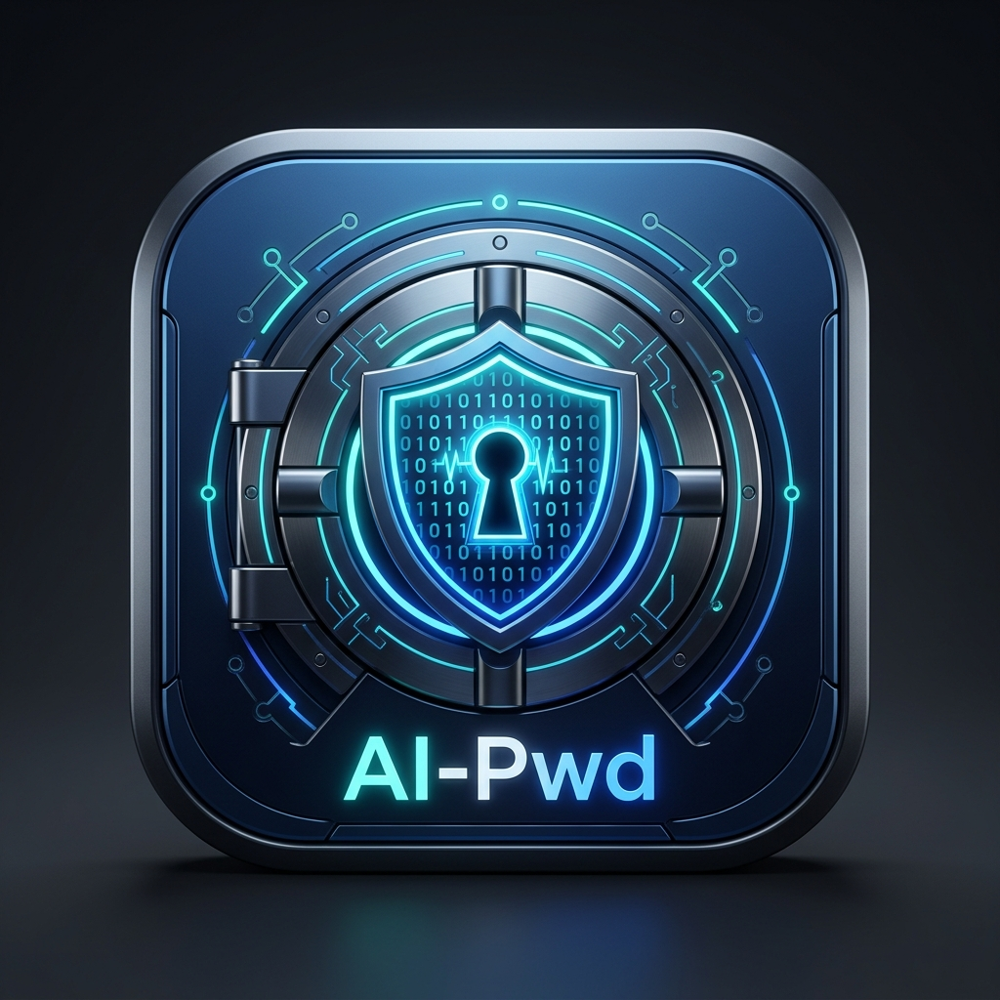

# AI-Pwd: 基于 ai-win-ui 与 SQLite 的现代 Windows 桌面密码生成器与保险库


-0078D4.svg)


**AI-Pwd** 是一款为 Windows 原生打造的高颜值、现代 Fluent 暗黑美学的**密码生成器与密码保管库**。应用基于 **`ai-win-ui`** 现代化桌面框架（Direct2D 硬件加速渲染 + DirectWrite 排版 + Meta Yoga 弹性盒布局），并使用内置原生 **SQLite 3** 进行本地安全持久化。

<p align="center">
  
</p>

---

## ✨ 核心特性

### 1. ⚡ 强随机密码生成器 (Password Generator)
- **硬件级真随机数**：基于 Windows CNG (`BCryptGenRandom`)，杜绝伪随机数预测漏洞。
- **Shannon 熵值估算与动态强度条**：实时评估密码熵值（如 105 bits），直观给出「极弱 / 中等 / 良好 / 强 / 极高安全」评分指示。
- **5 套常用预设一键生效**：
  - **强密码 16位**：兼顾绝大多数网站与系统的最佳长度与字符集。
  - **极高安全 24位**：超长高熵密码，专为服务器根凭据或核心资产打造。
  - **纯数字 PIN 码**：适用于银行交易、手机解锁、2FA 备用码。
  - **记忆短语 (Passphrase)**：基于安全词库组合的记忆型长密码。
  - **易读无混淆模式**：智能剔除 `1`、`l`、`I`、`0`、`O` 等肉眼极难辨识的字符。
- **快捷动作**：一键复制到 Windows 剪贴板、一键直接存入 SQLite 保险库。

### 2. ❖ 密码保险库与凭据管理 (Password Vault)
- **全方位凭据记录**：账号名称、分类标签、用户名/邮箱、强密码、登录网址 URL、备用码/备注信息。
- **实时分类与收藏置顶**：
  - 预置工作、社交、金融、邮箱、服务器等多色徽章分类。
  - 支持星标收藏（★）并提供专门的收藏夹快速筛选。
- **模糊搜索与即时过滤**：对账号标题、用户名、备注、网址进行毫秒级即时过滤。
- **便捷交互体验**：
  - **一键复制**：独立快速复制用户名或密码，操作后弹出绿色 Toast 提示反馈。
  - **明暗文切换**：默认掩码保护（`****************`），点击「显示」即可切换查看。
  - **一键直达**：点击网址旁的「访问」按钮，自动通过系统默认浏览器打开对应网站。
  - **增删改查**：完整的卡片编辑与安全删除确认。

### 3. 🔒 纯本地离线与 SQLite 安全存储
- **零网络外泄风险**：所有密码数据均存储在本地用户的应用数据目录 `%APPDATA%\ai-pwd\vault.db` 中。
- **原生 UTF-16 支持**：全流程采用 SQLite3 原生 UTF-16 接口（`sqlite3_open16` / `sqlite3_bind_text16` / `sqlite3_column_text16`），彻底杜绝 Windows 控制台与多语言字符集乱码。
- **存储监控指标**：实时统计当前收录凭据总数、弱密码风险提示条目数，一目了然。

### 4. 🎨 现代暗黑 Fluent 视觉规范
- **自定义沉浸式标题栏 (Custom Chrome)**：无缝融合深色标题栏与窗口控制按钮（最小化/最大化/关闭），支持标准无边框拖拽移动。
- **高 DPI 原生感知**：支持 100%、125%、150% 等任意 Windows 显示缩放比，界面元素与文字渲染锐利平滑。

---

## 🏗️ 架构与技术栈

```text
ai-pwd/
├── CMakeLists.txt              # CMake 构建配置（Release /MT 静态 CRT 链接）
├── third_party/
│   └── sqlite3/               # SQLite 3.46 官方 Amalgamation 源码
│       ├── sqlite3.c
│       └── sqlite3.h
└── src/
    ├── main.cpp                # 应用程序入口 (wWinMain、DPI 感知配置)
    ├── app/
    │   ├── app_controller.h    # 核心事件总线、状态流转与窗口生命周期
    │   ├── app_controller.cpp
    │   └── clipboard_helper.h  # Win32 原生剪贴板交互工具
    ├── db/
    │   ├── vault_db.h          # SQLite 封装层 (CRUD、统计、初始化测试数据)
    │   └── vault_db.cpp
    ├── generator/
    │   ├── pwd_generator.h     # 强随机数生成、Shannon 熵值计算与预设配置
    │   └── pwd_generator.cpp
    └── ui/
        ├── layout_builder.h    # 基于 ai-win-ui 规范的动态 XML 布局渲染器
        └── layout_builder.cpp
```

- **GUI 引擎**：`ai-win-ui` (Direct2D 1.1 + DirectWrite + Meta Yoga 3.2 flexbox)
- **数据库**：SQLite 3.46.0 C API (Amalgamation)
- **安全与加密**：Windows CNG (`BCryptGenRandom` via `bcrypt.lib`)
- **语言标准**：C++20 (MSVC 2022)
- **运行时环境**：Static CRT (`/MT`)，单独立即可运行的独立可执行程序

---

## 🛠️ 编译与构建

### 1. 编译前环境要求
- Windows 10 / 11 64-bit
- Visual Studio 2022 (包含 C++ 桌面开发组件及 MSVC v143 编译器)
- CMake 3.20 或更高版本
- 本地已编译的 `ai-win-ui` 静态库（位于 `F:/AI-Projects/ai-win-ui`）

### 2. CMake 编译命令
在项目根目录下打开 PowerShell 执行：

```powershell
# 1. 生成构建工程
cmake -B build -G "Visual Studio 17 2022" -A x64

# 2. 编译 Release 产物
cmake --build build --config Release
```

构建成功后，在 `build/Release/` 目录下将生成单文件可执行程序：
- `build/Release/ai_pwd.exe` (体积约 7.8 MB，内置 SQLite 引擎与 Direct2D/Yoga 渲染管线)

---

## 🚀 运行应用

直接双击运行 `build/Release/ai_pwd.exe` 即可启动。

支持以下可选命令行测试参数：
```powershell
# 启动时直接进入密码保险库面板
.\build\Release\ai_pwd.exe vault

# 启动时直接弹出新建凭据表单
.\build\Release\ai_pwd.exe edit
```

---

## 📂 数据库文件位置与备份

- **数据库路径**：`%APPDATA%\ai-pwd\vault.db`
- **迁移与备份**：只需复制该 `vault.db` 文件至新设备的相同路径，即可完成全部密码库的无缝迁移。
